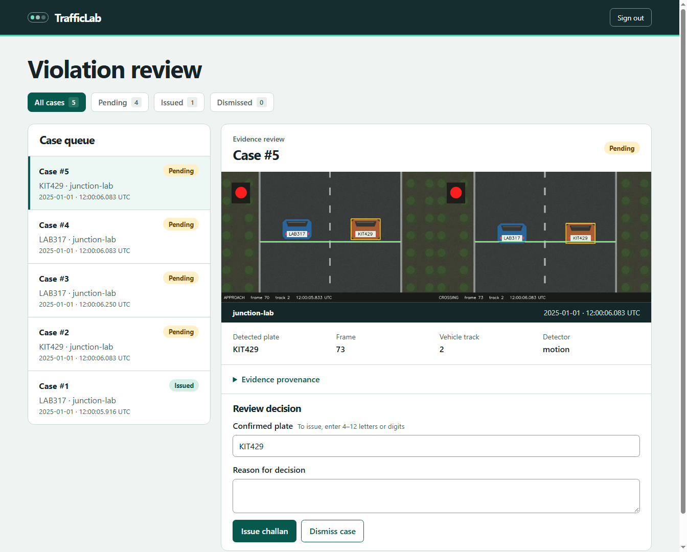
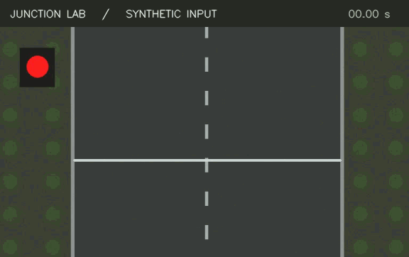
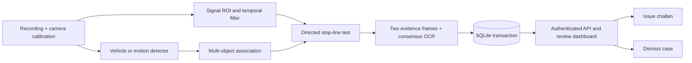

# Smart Traffic Violation Detection System

**TrafficLab** turns a fixed-camera recording into a reviewable record of a red-light crossing. Each candidate includes two frames from the same track, the signal in context, UTC timestamps and a plate reading when multiple OCR observations agree. A reviewer can dismiss the case or confirm a plate and issue a locally numbered challan.



The screenshot shows five candidates produced from generated video. The first release targets one operator and a calibrated, fixed, constant-frame-rate camera. Field accuracy and operational enforcement suitability remain unmeasured.

## Try it with a synthetic intersection

Use Python **3.11–3.13** and Tesseract with English language data on your executable path. On Debian/Ubuntu install `tesseract-ocr tesseract-ocr-eng`. On Windows verify the native installation with `tesseract --list-langs`. The Docker image includes English OCR.

```sh
python -m venv .venv
# Activate with .venv\Scripts\Activate.ps1 on PowerShell, or:
. .venv/bin/activate
python -m pip install --require-hashes -r requirements.lock
python -m pip install --no-deps .
python -m trafficlab.experiment --out runs/lab --generate-only
trafficlab analyze runs/lab/clips/daylight.avi --config demos/camera.json --start 2025-01-01T12:00:00Z --detector motion
```

The daylight clip has one red crossing and one green crossing. The command creates `instance/traffic.sqlite`. Repeat it to reuse the completed analysis. Use `--no-ocr` for an event-only run in a separate database.

Generate two independent secrets in your current terminal. The operator token signs you in. The session key stays on the server.

**PowerShell**

```powershell
$env:TRAFFIC_TOKEN = python -c "import secrets; print(secrets.token_urlsafe(32))"
$env:TRAFFIC_SECRET = python -c "import secrets; print(secrets.token_urlsafe(32))"
$env:TRAFFIC_TOKEN | Set-Clipboard
trafficlab serve
```

**Bash**

```sh
export TRAFFIC_TOKEN="$(python -c 'import secrets; print(secrets.token_urlsafe(32))')"
export TRAFFIC_SECRET="$(python -c 'import secrets; print(secrets.token_urlsafe(32))')"
printf '%s\n' "$TRAFFIC_TOKEN"
trafficlab serve
```

Open the [local dashboard](http://127.0.0.1:8080), sign in with the token, and compare the approach and crossing frames. Confirm the plate against the image, enter a reason and record a decision. Issuance creates a challan ID inside this database. External fine delivery and payments are outside this release.

<details>
<summary>Watch the generated input clip</summary>



</details>

## How a case is created



| Component | Implementation choice |
| --- | --- |
| Vehicles | A pretrained TorchVision SSDLite model recognizes cars, buses, trucks and motorcycles. The synthetic demo uses a fixed-camera foreground detector that runs offline. |
| Tracking | One-to-one assignment uses predicted position and box width. Short detection gaps preserve identity. Evidence uses observed vehicle positions. |
| Decision | A stable red indication must cover approach and crossing. The bottom center must traverse the calibrated line segment in the specified direction. A dead band suppresses jitter. |
| Plate recognition | Contrast enhancement and plate-shaped regions feed Tesseract. At least two agreeing reads are required. Unreadable plates remain open for review. |
| Records | Source and evidence hashes, recording start, camera geometry and detector configuration accompany each case. The operator's confirmed plate and decision are stored separately from the observed OCR. |

## Evaluate it

```sh
python -m unittest discover -s tests -v
python -m trafficlab.experiment --out runs/reference
```

The reference motion-backend run covers **8 synthetic clips, 1,152 frames, and 6 physical red crossings**.

| Outcome | Measured result |
| --- | ---: |
| Matched / missed / unmatched candidates | 5 / 1 / 0 |
| Event precision / recall / F1 | 1.000 / 0.833 / 0.909 |
| Exact plates among matched crossings | 5 of 5 |
| Correct crossing **and** plate among all physical red crossings | 5 of 6 |

The missed vehicle was completely hidden at the line. These counts describe one generated camera, two invented plates and a small, known set of trajectories. The research guide includes every scene, prediction, matching tolerance and the protocol for evaluating a held-out camera. [Evaluation and limitations](docs/evaluation.md) · [Machine-readable results](docs/research/reference.json)

## Work with your own recording

Install the `coco` extra in the active environment with `python -m pip install ".[coco]"`. The first run downloads TorchVision's official SSDLite COCO weights. For an offline site, prepare the matching TorchVision installation and model cache before moving the system. Use a CPU-specific PyTorch build when appropriate. [TorchVision model](https://docs.pytorch.org/vision/stable/models/generated/torchvision.models.detection.ssdlite320_mobilenet_v3_large.html) · [PyTorch installation](https://pytorch.org/get-started/locally/)

Copy `demos/camera.json`, set the camera ID, road crop, signal crop and directed stop line, then preview them on an actual frame. Supply the true recording start time with its UTC offset.

```sh
trafficlab calibrate junction.mp4 --config camera.json --frame 30 --out runs/calibration.png
trafficlab analyze junction.mp4 --config camera.json --start 2025-01-01T18:00:00+06:00 --detector coco
```

[Camera setup, Docker and operations](docs/operations.md) · [API contract](docs/api.md) · [Architecture and engineering assessment](docs/architecture.md) · [Contributing](CONTRIBUTING.md) · [MIT license](LICENSE)
