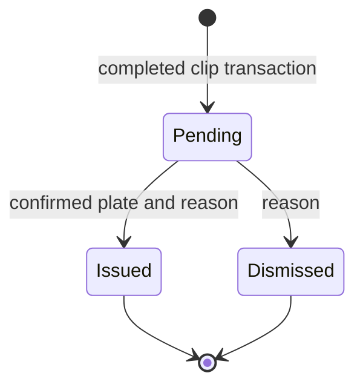

# Architecture and engineering assessment

## Repository audit

The upstream baseline was commit `75255d4`. The remote advertised one branch, `main`, with a single initial commit. Its tree contained the MIT license and a README title. Implementation therefore began from a clean baseline after the project owner chose a fixed camera, Latin-script plates and synthetic-first evaluation. The original license is preserved.

## From frames to a durable decision

1. `config.py` validates normalized geometry. `calibration.py` renders the crop and direction for operator inspection.
2. `detection.py` crops the road and returns normalized boxes. The COCO model uses four vehicle classes at a fixed score threshold of 0.55. The MOG2 baseline requires a stationary camera and a clear initial background. Its foreground label may also describe a person, shadow or moving object.
3. `tracking.py` predicts each active track's bottom center with damped frame-to-frame velocity. Distance and scale gates remove implausible matches before global linear assignment. Tracks expire after a short gap. Adjacent vehicles that merge into one detection can still swap or lose identities.
4. `rules.py` compares red, green and amber pixel support inside the signal ROI and abstains on weak or competing colors. Three consecutive compatible observations establish a signal. The oriented segment test requires a tracked approach on stable red, an observed downstream position, a valid intersection between endpoints, and enough hits to establish the track. Red must persist across both observations. A track emits at most one candidate.
5. `pipeline.py` retains a bounded recent frame window and a last approach image per armed track. Evidence shows the approach and downstream confirmation with the target, line, frame number and UTC time. `plates.py` uses local contrast enhancement, bright elongated contours, Tesseract and agreement across recent observed crops. Split-line, oblique, very small and dark-background plates can yield an abstention or an incorrect read.
6. `store.py` separates evidence blobs from indexed case rows. Unique run keys prevent duplicate imports. A guarded update finalizes each case once, even across concurrent requests. A process crash before commit leaves the durable queue unchanged. A hard kill can leave temporary staging files on disk.
7. `web.py` serves a server-rendered dashboard and JSON API from the same review operation. The interface can run without JavaScript. Bearer tokens and signed browser sessions protect both records and evidence.

## Assessment for engineering and research review

| Review dimension | Evidence in this release | Open requirement for field deployment |
| --- | --- | --- |
| Correctness | Regression tests cover finite geometry, slow crossings, short occlusion, signal ambiguity, clock offsets and one complete decode-to-case run. | Audit against camera-day holdouts and local traffic rules. |
| Reliability and data integrity | Atomic clip commits, WAL, evidence digests, repeat-import handling and concurrent review tests. | Exercise disaster recovery, disk exhaustion and sustained ingest load at the intended site. |
| Security and privacy | Authenticated evidence, CSRF checks, bounded inputs, parameterized SQL, non-root image and generated public demo assets. | Named reviewers, key management, retention, independent audit logs and deployment security review. |
| Maintainability | Separate detection, tracking, decision, storage and presentation modules. Hash-locked base dependencies, formatted code, container packaging and CI checks. | Migrate schemas deliberately as new versions are released and verify operational upgrades on backup copies. |
| Research reproducibility | Generated pixels and independent trajectory labels, sealed dataset manifest, one-to-one event scoring and published per-scene predictions. | Larger multi-site dataset, component ablations, uncertainty estimates and independent replication. |
| Social impact | Operators can inspect evidence, correct OCR, dismiss spurious candidates and see the basis for a local challan. | Measure review workload, false accusations, visibility differences by vehicle class, and appeal outcomes with affected communities. |

The project is a reproducible engineering and research prototype. There is no measured reduction in crashes, reviewer workload or community harm, and no claim of standards certification.
