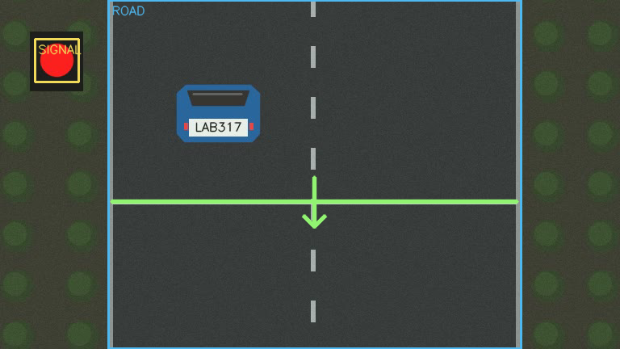

# Camera setup and operations

## Calibrate a camera

Use a fixed lens and a constant-frame-rate recording with a known start time. In `camera.json`, divide pixel x coordinates by the full image width and y coordinates by its height. The image origin is the top-left. Values range from 0 to 1.

| Field | Meaning |
| --- | --- |
| `camera` | Stable identifier for the camera and approach |
| `road_roi` | Left, top, right, bottom of the road region the detector receives |
| `signal_roi` | Tight rectangle around the controlling lamp or unambiguous signal head |
| `stop_line` | Two endpoints on the painted line spanning the relevant lanes |

Run `trafficlab calibrate VIDEO --config camera.json --frame 30 --out runs/overlay.png`. Inspect the colored regions and crossing arrow. The arrow should point from the approach into the intersection. Swap the line endpoints to reverse it. Keep unrelated lamps, reflections and other movements out of the signal crop. Use a separate calibration per independently controlled approach. Recalibrate after camera movement or reframing.



Verify at least one legal passage, one stopped vehicle and one red crossing on labeled development footage. Test accuracy on a separate set of complete clips. A bounding box touching the line can occur before a real wheel crosses it. Camera perspective and box truncation affect this proxy. Variable-frame-rate video, scene cuts, clock drift, lane-specific arrows and permissive turns require additional handling.

## Operate the console

`trafficlab serve` runs Waitress on loopback port 8080. Keep the two secrets in a secret store for persistent operation. Rotate both to invalidate existing signed sessions and API access. Session cookies expire after eight hours, use HttpOnly and SameSite=Strict, and can require HTTPS with `--secure-cookie`. Put remote access behind TLS and restrict the upstream network. There is one operator identity. Per-person attribution requires an identity provider and a reviewer identity column before a shared deployment.

The API process and CLI can use the same local SQLite database. Each process opens short-lived connections with WAL and a busy timeout. The analyzer stages candidate evidence in the database directory while decoding. It atomically commits the run, cases and JPEGs after a complete decode. A duplicate import with identical settings reuses the result. The same source under different settings for the same camera requires a separate experiment database. Hashes identify the recording and evidence bytes. Trusted custody of originals and independent signatures are additional field requirements.

Point both commands at the same path with `--db PATH`. Keep the DB, its WAL files, source footage, backups and any interrupted staging directories on restricted encrypted storage. Full frames can include people or other vehicles. The demo data and screenshots use generated plates. Establish a retention period and a process for corrections and appeals before collecting private footage. This version has no automatic retention or redaction service.

For a consistent backup of a running instance use the SQLite backup API or the SQLite CLI backup command. A standalone copy of a live main database file can omit recent WAL changes. Restoring the full backup to an isolated path and opening the queue tests the recovery. Separate ingestion by camera only when workloads warrant it. Multi-host writers require a different storage design.

## Run with Docker

The image includes the CPU motion detector, web console and English OCR. It runs under UID 10001 and stores application data under `/app/instance`. The optional Torch backend is installed separately for native ingestion. The service can review a compatible database produced by either detector.

From the repository root, set `TRAFFIC_TOKEN` and `TRAFFIC_SECRET` as in the README. These commands use one persistent named volume.

```sh
docker build -t trafficlab:local .
docker volume create trafficlab-data
docker run --rm -v trafficlab-data:/app/instance --entrypoint python trafficlab:local -m trafficlab.experiment --out /app/instance/lab --generate-only
docker run --rm -v trafficlab-data:/app/instance trafficlab:local analyze /app/instance/lab/clips/daylight.avi --config /app/demos/camera.json --start 2025-01-01T12:00:00Z --detector motion
docker run --rm -p 127.0.0.1:8080:8080 -e TRAFFIC_TOKEN -e TRAFFIC_SECRET -v trafficlab-data:/app/instance trafficlab:local
```

## Troubleshooting

| Symptom | Check |
| --- | --- |
| Video fails to open or decode count differs | Inspect codec support and the recording. Use a constant-frame-rate export, preserve its original time mapping and rerun. |
| No cases | Inspect calibration, line direction and signal visibility. A newly observed vehicle already beyond the line cannot establish an approach. Check `signal_frames` in the analyzer output. |
| Empty plate | Verify `tesseract --list-langs` includes `eng`. Inspect pixel size, glare and orientation in the evidence. Manual confirmation is required to issue a challan. |
| Slow inference | Compare the model, CPU/GPU, crop size, OCR settings and event density. Database commits and service response latency are separate from the experiment's analysis timing. |
| Rejected repeat decision | Reopen the case to see its final status and decision. The API returns 409 after another reviewer operation already finalized it. |
